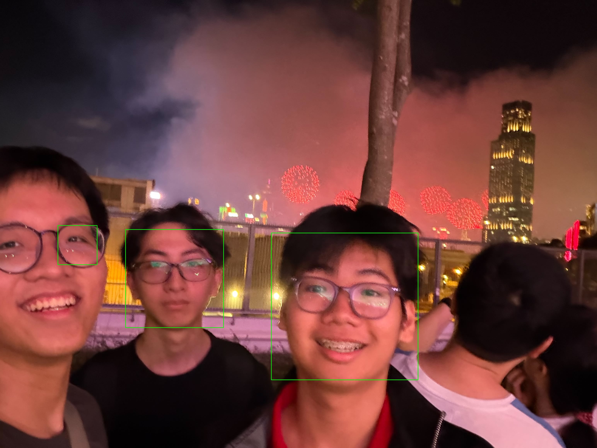

# OpenCV Face Detection

A simple computer vision project that detects human faces in images using OpenCV and Haar Cascade classifiers.

## Overview

This project uses OpenCV's pre-trained Haar Cascade model to identify and locate human faces in a static image. Detected faces are highlighted with green bounding boxes and saved as a new image.

## Features

- Face detection from images
- Image preprocessing using grayscale conversion
- Automatic face localization
- Bounding box visualization
- Result image export

## Technologies Used

- Python
- OpenCV
- Haar Cascade Classifier

## Project Structure

```text
opencv-face-detection/
├── face_detection.py
├── sample.jpg
├── result.jpg
├── haarcascade_frontalface_default.xml
└── README.md
```

## How It Works

1. Load an image
2. Convert the image to grayscale
3. Load the Haar Cascade face detector
4. Detect faces in the image
5. Draw bounding boxes around detected faces
6. Save and display the result

## Installation

```bash
pip install opencv-python
```

## Run

```bash
python face_detection.py
```

## Example

### Input


### Output



Faces detected in the image are highlighted with green rectangles.

## What I Learned

- Basic computer vision workflows
- Image preprocessing with OpenCV
- Object detection using Haar Cascade classifiers
- Working with image coordinates and bounding boxes
- Reading and writing images programmatically

## Future Improvements

- Real-time webcam face detection
- Face recognition
- Face mask detection
- Emotion recognition
- Deep learning based face detectors

## Author

Nam Trung Ta
